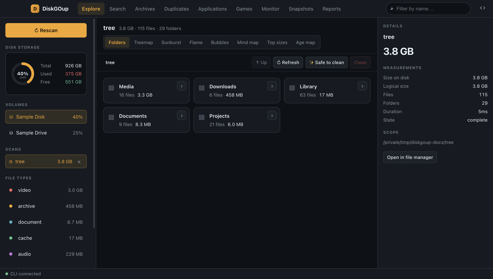
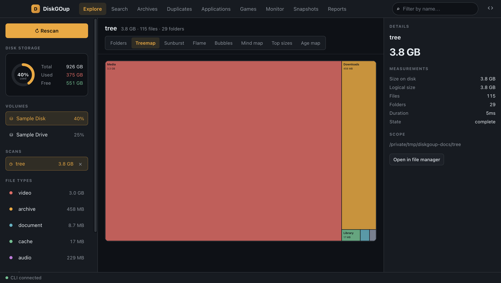
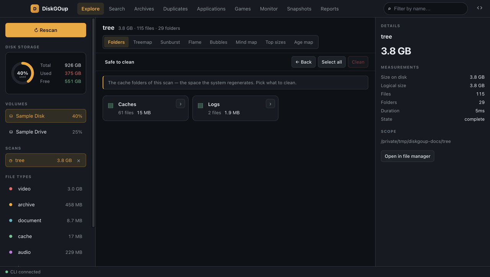
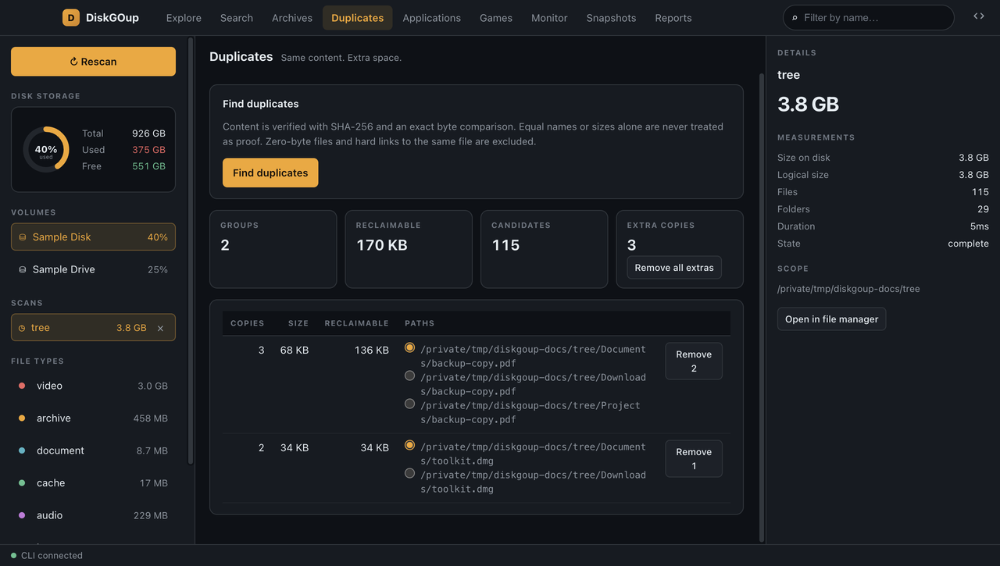
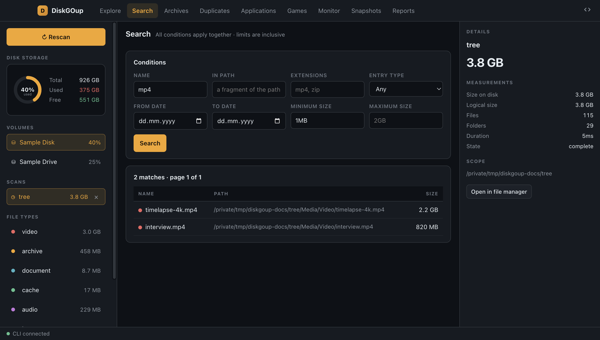
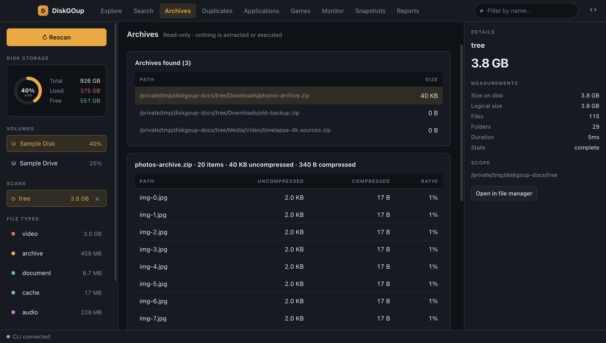
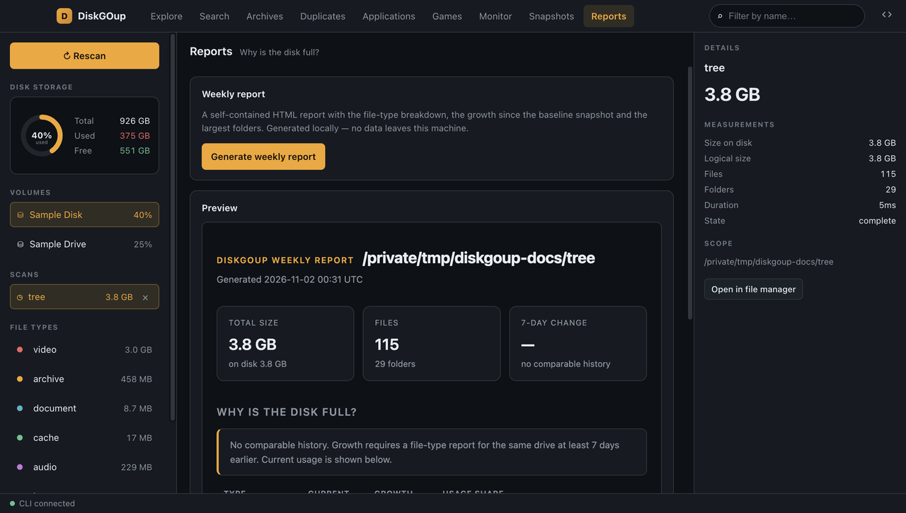

# DiskGOup

**Take Control of Your Disk Space. For Free.**

Open-source disk analyzer and duplicate finder for macOS, Windows and Linux —
desktop GUI and scriptable CLI.

[](LICENSE)
[](https://github.com/elshadaghazade/diskgoup/releases/latest)
[](#downloads)
[](https://diskgoup.vercel.app/)

DiskGOup shows you exactly where your disk space went — by folder, by file type,
by age, and by content duplication — and gives you a staged, reviewed cleanup flow
instead of a one-click "delete my stuff".

The **CLI is the product**. The Electron desktop app is a thin front-end that
drives the CLI as a child process.

---

## Documentation

**Official documentation: <https://diskgoup.vercel.app/>**

| Guide | What it covers |
|---|---|
| [Getting started](https://diskgoup.vercel.app/getting-started/quick-start/) | install the CLI or the desktop app and run your first scan |
| [Downloads](https://diskgoup.vercel.app/getting-started/downloads/) | every build, for every platform, with checksums |
| [Desktop app](https://diskgoup.vercel.app/desktop/overview/) | the window, its nine sections, the sidebar and focus mode |
| [Explore](https://diskgoup.vercel.app/desktop/explore/) | the folder browser, the eight chart views, the inspector and safe-to-clean |
| [Commands](https://diskgoup.vercel.app/reference/cli/) | the full CLI reference |
| [Cleanup guide](https://diskgoup.vercel.app/guide/cleanup/) | how the staged, reviewed cleanup works |
| [Development](https://diskgoup.vercel.app/development/building/) | how the CLI and the desktop app fit together, and how to release |

---

## Why this exists

Disk-space analysers are a mature — mostly paid — market. The commercial tools
in this space do a good job, but they are closed-source, each one targets a
single platform, and every one of them is GUI-only: you cannot script them,
and the tool you use on your laptop is rarely the tool you use on your
desktop.

DiskGOup does the same job those paid tools do, and does it **open-source and
cross-platform** — the same capabilities on **macOS, Linux and Windows**, with
an open, scriptable CLI at the centre and the desktop app on top of it.

---

## Status

| Area | State |
|---|---|
| Scan engine + SQLite index | ✅ working |
| Scan history — every scan kept, reusable, listable | ✅ working |
| Pausable scans — pause, resume and stop from the desktop app | ✅ working |
| Folder tree, size ranking, file-type report, age map | ✅ working |
| Drive/volume discovery (Windows, macOS, Linux) | ✅ working |
| All eight Explore views (treemap, sunburst, flame, bubbles, mind map, …) | ✅ table / JSON / SVG |
| Advanced search | ✅ working |
| Duplicate finder (SHA-256 + exact byte compare) | ✅ working |
| Archive browser (read-only, 64 KiB preview) | ✅ working |
| Staged cleanup → validate → confirm → recycle bin | ✅ working |
| Game library discovery (Steam / Epic) | ✅ working |
| Application inventory + uninstall | ✅ working |
| Live monitor | ✅ working |
| Snapshots + 7-day change | ✅ working |
| Weekly report (HTML) + type report (CSV) | ✅ working |
| `diskgoup serve` (JSON-RPC over stdio, for the GUI) | ✅ working |
| Electron + Vite desktop app | ✅ working — spawns the CLI, renders all nine sections |
| Desktop scan list | ✅ working — every stored scan is listed and can be opened or deleted |
| Factory reset | ✅ working — `diskgoup reset` / **⟲ Reset app** rebuilds the index from scratch |

---

## Desktop app

The desktop app is a **thin front-end over the CLI**, not a second
implementation. It starts `diskgoup serve` as a child process and asks it
questions over JSON-RPC on stdin/stdout — so every number in the window was
measured by the same Python code the command line uses. Delete the app and
nothing is lost.



> The screenshots below were taken from a **sample disk**: a synthetic folder
> tree, a made-up inventory of applications and a made-up game library. No
> real file, application or game of yours is in them.

<table>
<tr>
<td width="50%" valign="top">

<br><strong>Explore</strong> — the folder browser and eight chart views:
treemap, sunburst, flame, bubbles, mind map, top sizes and age map.
<br><a href="https://diskgoup.vercel.app/desktop/explore/">Explore →</a>
</td>
<td width="50%" valign="top">

<br><strong>Safe to clean</strong> — the caches and logs the operating system
regenerates, staged for review instead of deleted on the spot.
<br><a href="https://diskgoup.vercel.app/guide/cleanup/">Cleanup guide →</a>
</td>
</tr>
<tr>
<td width="50%" valign="top">

<br><strong>Duplicates</strong> — identical content, found by SHA-256 and an
exact byte compare, with the extra copies grouped for review.
<br><a href="https://diskgoup.vercel.app/desktop/duplicates/">Duplicates →</a>
</td>
<td width="50%" valign="top">

<br><strong>Search</strong> — by name, path, type, date and size, with all the
conditions combined.
<br><a href="https://diskgoup.vercel.app/desktop/search/">Search →</a>
</td>
</tr>
<tr>
<td width="50%" valign="top">

<br><strong>Archives</strong> — look inside a ZIP without extracting anything.
<br><a href="https://diskgoup.vercel.app/desktop/archives/">Archives →</a>
</td>
<td width="50%" valign="top">

<br><strong>Reports</strong> — a weekly HTML report and a file-type CSV.
<br><a href="https://diskgoup.vercel.app/desktop/reports/">Reports →</a>
</td>
</tr>
</table>

The remaining sections — **Applications**, **Games**, **Monitor** and
**Snapshots** — are documented on
[the desktop app page](https://diskgoup.vercel.app/desktop/overview/).

---

## Downloads

Every release ships a standalone CLI binary and a desktop app, built by the
project's own CI and attached to the
[GitHub release](https://github.com/elshadaghazade/diskgoup/releases) of the
tag.

| | macOS | Linux | Windows |
|---|---|---|---|
| **CLI** | [arm64](https://github.com/elshadaghazade/diskgoup/releases/latest/download/diskgoup-cli-macos-arm64.tar.gz) · [x64](https://github.com/elshadaghazade/diskgoup/releases/latest/download/diskgoup-cli-macos-x64.tar.gz) | [x64](https://github.com/elshadaghazade/diskgoup/releases/latest/download/diskgoup-cli-linux-x64.tar.gz) · [arm64](https://github.com/elshadaghazade/diskgoup/releases/latest/download/diskgoup-cli-linux-arm64.tar.gz) | [x64](https://github.com/elshadaghazade/diskgoup/releases/latest/download/diskgoup-cli-windows-x64.zip) |
| **Desktop app** | [arm64](https://github.com/elshadaghazade/diskgoup/releases/latest/download/DiskGOup-macOS-arm64.dmg) · [x64](https://github.com/elshadaghazade/diskgoup/releases/latest/download/DiskGOup-macOS-x64.dmg) | [x64](https://github.com/elshadaghazade/diskgoup/releases/latest/download/DiskGOup-Linux-x64.AppImage) | [x64](https://github.com/elshadaghazade/diskgoup/releases/latest/download/DiskGOup-Windows-x64.exe) |

The links always point at the newest release. The CLI binary is
self-contained — no Python needed on the machine you run it on. The
desktop app bundles the same binary.

The full list is on the [downloads page](https://diskgoup.vercel.app/getting-started/downloads/).

### Unsigned installers

The macOS `.dmg` and the Windows `.exe` are **not code-signed and not
notarized** — the project publishes no certificate — so **Gatekeeper and
SmartScreen warn on the first launch.** The Linux AppImage is unaffected.

That warning is the operating system asking, not the app failing. Whether to
allow an unsigned build on your own machine is your decision, and your
responsibility.

| Platform | What you see | What to do |
|---|---|---|
| macOS | "cannot be opened because the developer cannot be verified" | right-click the app in the mounted `.dmg` → **Open** → **Open**, or **System Settings → Privacy & Security → Open Anyway** |
| Windows | "Windows protected your PC" | **More info** → **Run anyway** |

If you would rather not allow an unsigned binary at all, two other roads lead
to the same program:

- **Verify the download.** Every release ships the SHA-256 of each file in
  `checksums-cli.txt` and `checksums-desktop.txt` —
  `sha256sum --check checksums-desktop.txt`.
- **Build it from source** — see [Build for production](#build-for-production)
  below, or
  [the building guide](https://diskgoup.vercel.app/development/building/).

---

## Quick start

### What you need

- Python **3.12+**
- [`uv`](https://docs.astral.sh/uv/) — installs Python and manages the environment
- Node **20+** — only for the desktop app

### Prepare the project (once)

**You do not have to install anything by hand.** `uv sync` creates a private
virtual environment in `.venv/` and installs the CLI together with the tools
that build it; `npm install` installs the Node packages for the renderer and
the Electron shell. No global installs, no manual steps, no "install the CLI
first".

```bash
git clone https://github.com/elshadaghazade/diskgoup.git
cd diskgoup

uv sync                        # Python environment + CLI + build tools
npm --prefix ui install        # renderer packages
npm --prefix electron install  # Electron packages
```

> `npm --prefix <folder> <command>` simply means "run this inside `ui/` or
> `electron/`". Every command below works from the repository root — there is
> no need to `cd` around.

### Run the desktop app

Two terminals, because the renderer is a Vite dev server and the app is a
separate process:

```bash
# terminal 1 — the renderer, on http://localhost:5173
npm --prefix ui run dev

# terminal 2 — the app
npm --prefix electron run dev
```

The second command does the rest: it compiles the Electron main process,
**builds the CLI binary** with PyInstaller, copies it into
`electron/resources/` and opens the window. The app therefore always talks to
your current code — there is no separate "install the CLI" step.

Changes to the renderer reload on save. Changes to Python need
`npm --prefix electron run build:cli` (or a restart of the dev command) to be
picked up.

If the CLI binary is missing, the app refuses to start and tells you exactly
which command to run — a blank window is never left in front of you.

### Use the CLI on its own

The same environment, no Electron involved:

```bash
# List the volumes on this machine
uv run diskgoup drives

# Scan a drive or folder (stored in a persistent index)
uv run diskgoup scan ~/

# Every scan is kept — list them, reopen one, prune them
uv run diskgoup scans
uv run diskgoup tree ~/ --scan-id 3
uv run diskgoup scans remove 3

# Explore the result — one scan, many views
uv run diskgoup tree ~/ --depth 2
uv run diskgoup sizes ~/ --limit 25
uv run diskgoup types ~/
uv run diskgoup treemap ~/ -o treemap.svg

# Find and review duplicates
uv run diskgoup duplicates ~/

# Stage a cleanup, review it, then commit it to the recycle bin
uv run diskgoup cleanup stage ~/Downloads/old-archive.zip
uv run diskgoup cleanup list
uv run diskgoup cleanup validate
uv run diskgoup cleanup commit

# Machine-readable output for scripting
uv run diskgoup --json types ~/ | jq '.types[0]'

# Start over from scratch — replaces a corrupted or stuck index
uv run diskgoup reset
```

Every command accepts `--json`, which is how the desktop app consumes the CLI.
Run `uv run diskgoup --help` for the full surface.

---

## Build for production

### The desktop app

```bash
npm --prefix ui run build        # renderer → ui/dist
npm --prefix electron run build  # main process + CLI binary + renderer → electron/dist
npm --prefix electron start      # run the production build
```

### Installers

```bash
npm --prefix electron run dist:mac      # .dmg (arm64 + x64)
npm --prefix electron run dist:win      # .exe (NSIS installer)
npm --prefix electron run dist:linux    # AppImage
```

The installers land in `electron/release/`. The CLI binary is bundled inside
the app, so an installer is self-contained — it does not need Python on the
target machine.

### The CLI on its own

```bash
uv run pyinstaller diskgoup.spec
```

→ `dist/diskgoup` (`dist\diskgoup.exe` on Windows): one self-contained binary
that runs anywhere, with no Python installation required.

---

## How it works

```
diskgoup/
├── src/diskgoup/     Python CLI (uv project) — all the disk logic
├── electron/         Electron main process (TypeScript)
├── ui/               Vite + React renderer (TypeScript)
├── site/             Astro + Starlight documentation site
└── scripts/          release helpers — version, artifact names, publishing
```

The renderer contains **no disk logic**. The Electron main process spawns the
compiled CLI and talks to it over newline-delimited JSON-RPC on stdin/stdout.
Delete the GUI and nothing is lost — every capability is still on the command
line.

One scan powers every view: the walk is written into a persistent SQLite
index, and the tree, the treemap, the search, the duplicate finder and the
reports all read that same result set instead of touching the disk again.

### The cleanup contract

Nothing is ever deleted straight away:

```
stage → review → validate → confirm → revalidate → recycle bin
```

Protected paths — system directories, protected application data, game files and
saves — can never be staged. Cancelling leaves every file exactly where it was.

---

## Development

```bash
uv run pytest                            # tests
uv run ruff check . && uv run ruff format .
uv run mypy                              # strict type check

npm --prefix ui run typecheck            # renderer types
npm --prefix electron run build:electron # Electron main process types
```

See [CONTRIBUTING.md](CONTRIBUTING.md) for the rules that matter when you
contribute — the short version: **the CLI is the product**, so new capability
goes into `src/diskgoup/` and the GUI only presents it.

---

## Credits

- **[goup.vc](https://goup.vc/)** — the DiskGOup community. This project is
  built with and for the people there: ideas, bug reports, design opinions and
  pull requests are all welcome.
- **The disk-analysis tools that came before** — the commercial analysers and
  cleaners that showed the whole category what a disk analyser should do. This
  project follows the same ground, but open-source, cross-platform and with a
  CLI at the centre.

---

## License

[MIT](LICENSE) © DiskGOup contributors
